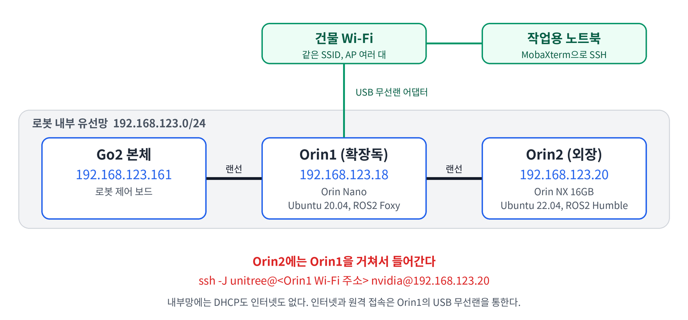

Go2 EDU에 Jetson 두 대를 붙이고 나서 한동안 ROS2 코드보다 네트워크 설정에 시간을 더 썼다. 로봇 내부망의 주소 구조, Orin2에 SSH로 들어가는 방법, 설정하다가 인터넷이 끊기거나 ping이 안 갈 때 확인한 것들을 정리한다.

## 환경

- 로봇: Unitree Go2 EDU
- Orin1: 확장독 안의 Jetson Orin Nano, Ubuntu 20.04, JetPack 5, ROS2 Foxy
- Orin2: 외장으로 붙인 Jetson Orin NX 16GB, Ubuntu 22.04, JetPack 6.2.2, ROS2 Humble
- 작업용 PC: Windows 노트북, MobaXterm으로 SSH 접속

## 구조



랜선은 Go2, 확장독, Orin2 순서로 이어져 있다. 확장독 앞쪽 포트가 Go2, 뒤쪽 포트가 Orin2다. 세 장비는 `192.168.123.0/24` 내부망 안에 있고, 이 망에는 DHCP 서버도 인터넷도 없다.

Orin1의 OS에서는 `eth0` 하나만 보이는데, Orin2에서 Go2와 Orin1 둘 다 닿는다.

```bash
ping -c 4 192.168.123.161   # Go2 본체: 손실 0%, 왕복 1ms 미만
ping -c 4 192.168.123.18    # Orin1: 손실 0%, 왕복 1ms 미만
```

인터넷과 원격 접속은 무선으로 따로 만들었다. USB 무선랜 어댑터를 Orin1에 꽂아 건물 Wi-Fi에 붙였다.

## 증상 1. Orin2에 노트북에서 바로 접속이 안 된다

Orin2는 내부망에만 물려 있어서 노트북에서 `192.168.123.20`으로 직접 갈 길이 없다. Orin2에도 USB 무선랜을 꽂아 봤지만 계속 끊겼다. 서로 다른 칩셋의 어댑터 두 개가 같은 순간에 떨어졌고, 다른 USB 포트로 옮겨도 똑같았다. 캐리어 보드의 USB 허브 문제로 보고, 무선랜은 Orin1에만 두기로 했다.

Orin1을 점프 호스트로 거치면 된다.

```bash
ssh -J unitree@<Orin1의 Wi-Fi 주소> nvidia@192.168.123.20
```

`-J`는 Orin1에 먼저 접속한 뒤 거기서 Orin2로 넘어가는 옵션이다.

로봇 전원을 껐다 켜면 Orin2의 유선 링크도 4분쯤 같이 끊긴다. 로봇 내부 스위치를 거치는 경로라서 생기는 일이고, 기다리면 돌아온다. 로봇을 만지지 않았는데 끊기면 위의 USB 허브 문제를 의심한다.

## 증상 2. 내부망 주소를 넣었더니 인터넷이 끊긴다

Orin2의 유선 인터페이스에 `192.168.123.20`을 주고 나서 Wi-Fi 인터넷이 사라졌다. `ip route`를 보면 이유가 나온다.

```
default via 192.168.123.1 dev eth1 proto static metric 20100
default via 192.168.1.1   dev wlan0 proto dhcp   metric 20600
```

기본 경로가 둘이고, 숫자가 작은 쪽이 이긴다. 유선 프로파일에 게이트웨이까지 넣으면 인터넷으로 이어지지 않는 `192.168.123.1`이 기본 경로를 가져가고, 인터넷으로 나가는 패킷이 길을 잃는다. 내부망 프로파일은 고정 주소로 두고, 기본 경로가 되지 않게 막는다.

```bash
sudo nmcli connection modify "<유선 프로파일>" \
  ipv4.method manual ipv4.addresses 192.168.123.20/24 ipv4.never-default yes
sudo nmcli connection up "<유선 프로파일>"
```

`ipv4.method auto`로 두면 DHCP 서버가 없는 망에서 주소를 계속 기다리기만 한다. 아래는 그때 `nmcli device status`에 보인 상태다.

```
br0   bridge   연결 중 (IP 설정 가져오는 중)   br0
```

고친 뒤에는 `ip route`에서 `default`가 `wlan0` 쪽 하나만 남았는지, `ping -c 3 8.8.8.8`이 손실 없이 나가는지 본다.

## 증상 3. 같은 인터페이스에 프로파일이 두 개다

증상 2를 고치기 전에 유선 연결이 연결됐다 끊기기를 반복했다. 원인은 같은 MAC, 같은 인터페이스(`eth1`)를 가리키는 NetworkManager 프로파일이 두 개였고, 둘 다 `autoconnect: yes`에 DHCP(`ipv4.method auto`)였다는 점이다. 둘이 번갈아 주소를 요청하다가 실패했다.

```bash
nmcli connection show                       # 이름이 다른데 같은 장치를 쓰는 항목이 있는지
nmcli connection show <UUID> | grep -E "interface-name|mac-address|autoconnect|ipv4.method"
sudo nmcli connection delete <중복된 UUID>
```

중복을 지우고 고정 주소를 주자 `eth1`이 `192.168.123.20/24`로 안정됐다.

## 증상 4. 노트북 Wi-Fi 어댑터 하나로 로봇망과 인터넷을 같이 쓰면 끊긴다

노트북에서 로봇 내부망에 직접 붙으려고 Wi-Fi 어댑터에 고정 주소를 하나 더 얹었다.

```
netsh interface ip add address "Wi-Fi" 192.168.123.100 255.255.255.0
```

이 명령을 칠 때마다 노트북 인터넷이 끊겼다. 서로 다른 두 대역을 한 어댑터에 올려서 생기는 문제로 보이고, 이 노트북의 내장 Wi-Fi 7 어댑터에서는 매번 똑같이 재현됐다. 어댑터를 나눠서 해결했다. 내장 어댑터는 인터넷용으로 두고, USB 무선랜 어댑터는 로봇망 접속용으로 썼다.

## 증상 5. 같은 SSID에 붙었는데 ping이 안 간다

노트북과 Orin Nano가 같은 SSID에 붙어 있었는데 서로 ping이 가지 않았다. IP 설정을 아무리 바꿔도 소용이 없었다. AP 격리(client isolation)가 켜져 있으면 AP가 무선 기기끼리의 통신을 막는다. 인터넷은 되는데 같은 망의 다른 기기에는 안 닿는 증상이면 IP를 만지기 전에 이것부터 의심하는 편이 빠르다.

그 공유기는 내 것이 아니라서 설정을 열어 보지 못했다. 대신 Orin Nano가 일반 공유기에서 DHCP로 받은 주소로 SSH를 연결해서 우회했다.

## 명령을 어디서 치는지 먼저 본다

설정 명령을 엉뚱한 장비에 친 일이 여러 번 있었다. 프롬프트로 구분한다.

| 프롬프트 | 장비 |
|---|---|
| `unitree@ubuntu` | Orin1 |
| `nvidia@nvidia-desktop` | Orin2 |

## 상태 확인 명령

```bash
ip -br addr                 # 인터페이스별 주소
ip route                    # default가 wlan0 쪽 하나인지
ping -c 3 192.168.123.161   # Go2 본체
ping -c 3 192.168.123.18    # Orin1
nmcli connection show       # 같은 장치를 가리키는 중복 프로파일이 없는지
```

## 확인하지 못한 것

- 확장독 안에 이더넷 포트 두 개를 묶는 스위치가 있어서 OS에는 포트 하나로 보이는 것 같다. 문서로는 확인하지 못했다.
- 증상 4에서 인터넷이 끊기는 정확한 원인(패킷의 출발지 주소 선택으로 짐작)은 확인하지 못했다.
- 증상 5의 원인이 AP 격리라는 것은 증상으로 판단한 것이고, 공유기 설정으로 확인하지는 못했다.
